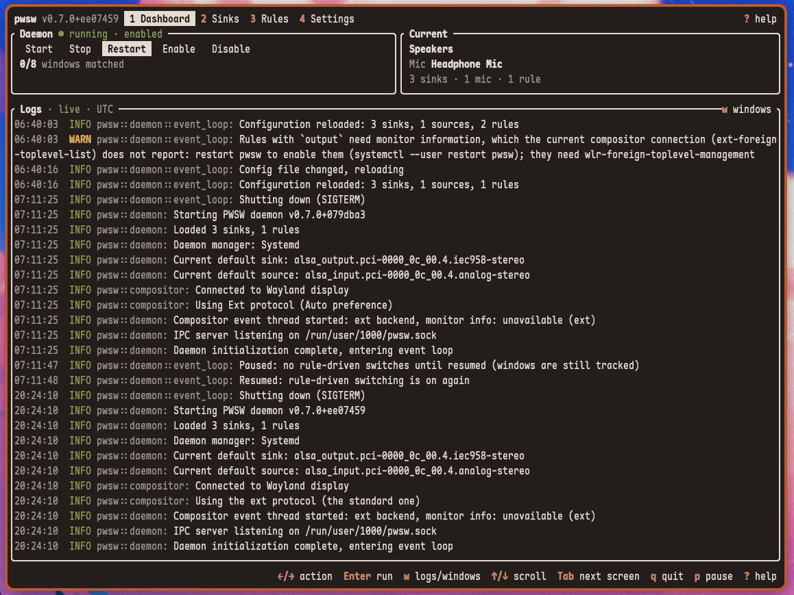
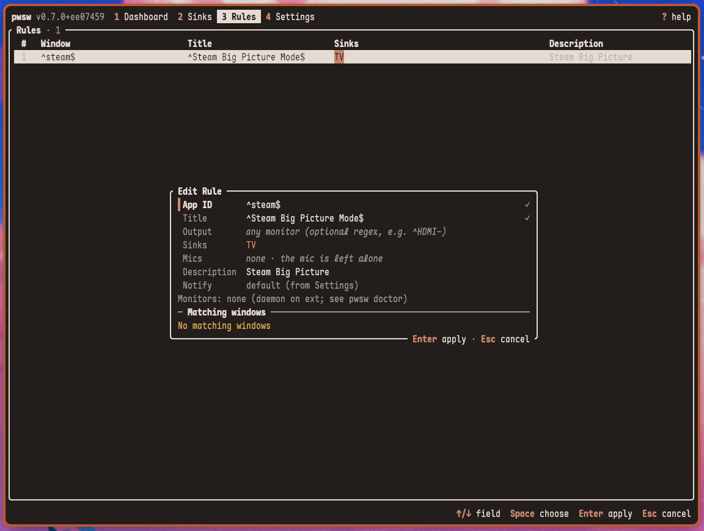
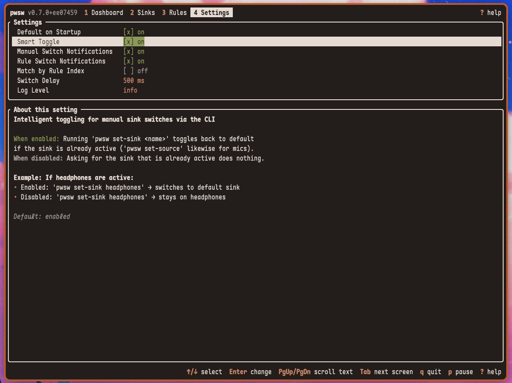

# <p align="center">PWSW - PipeWire Switcher</p>

<p align="center">
  <a href="https://github.com/ledati16/pwsw/actions/workflows/ci.yml"></a>
  <a href="LICENSE"></a>
  <a href="https://www.rust-lang.org/"></a>
  <a href="Cargo.toml"></a>
  <a href="https://ratatui.rs/"></a>
  <a href="#about-the-code"></a>
</p>

> **PWSW is feature complete.** It may get maintenance and updates in the future as
> needed (dependency and security updates, bug fixes), but otherwise it is considered
> finished. See [CHANGELOG.md](CHANGELOG.md) for what changed.

PWSW switches your PipeWire audio output automatically, based on the windows you have
open on Wayland. Launch a game and the sound goes to the speakers; open Discord and it
moves to the headset; close it and it comes back. It can switch the microphone too,
follow a window to the screen it is on, and fall back to a second device when the first
one isn't there.

<p align="center"></p>

<p align="center">
  
  
</p>

## Features

**Switching**
- Rules match a window's `app_id`, title and/or the monitor it is on (regex)
- **Microphones too** (optional): a rule can also pick the default input, decided
  independently of the output, so a rule without a mic never moves it
- **Fallbacks**: a rule can list several outputs (or mics); the first one available
  right now wins, and pwsw moves up when a better one comes back
- **Audio follows the screen**: `output = "^HDMI-A-1$"` sends whatever is on the TV to
  the TV
- **Respects your choices**: pwsw only switches when its rules' answer changes, so
  something you pick in pavucontrol (or with `pwsw set-sink`) stays put
- **Profile switching**: reaches outputs that need a card profile change (analog ↔
  digital, HDMI), keeping the card's microphone, and switching the card back if the new
  output doesn't show up
- Priority: most recently opened window wins, or the first matching rule
- Pause/resume, and an optional settle delay for windows that only match for a moment

**Using it**
- **Terminal UI**: dashboard with daemon controls, live log and window list; rule editor
  with a live preview of matching windows (or press `n` on a window to start a rule from
  it); sink and mic editors that pick from what PipeWire offers; built-in help
- **`pwsw doctor`** checks the whole setup and tells you what to fix
- **Live status for bars and shells**: `pwsw status --watch --json` (Waybar, eww,
  Quickshell, DankMaterialShell; a [Noctalia plugin](contrib/noctalia/) is included)
- Desktop notifications, hot reload on save, `--json` output, shell completions, man
  pages, and a systemd user unit that shows the current output in `systemctl status`

## Requirements

- A Wayland compositor with **`ext-foreign-toplevel-list-v1`** or
  **`wlr-foreign-toplevel-management`**, for example Sway, Hyprland, niri, river,
  Wayfire, labwc or COSMIC. Matching by monitor needs the `wlr` one. GNOME and KDE
  Plasma 6 don't offer either. Not sure? `pwsw doctor` tells you.
- PipeWire with its command-line tools (`pw-dump`, `pw-cli`, `pw-metadata`), normally
  with WirePlumber.
- Optional: a notification server (mako, dunst, swaync, ...).
- To build: Rust 1.100 (`rustup` picks it up from `rust-toolchain.toml`).

## Install

**Arch Linux** (PKGBUILD in `contrib/`):

```bash
git clone https://github.com/ledati16/pwsw && cd pwsw/contrib
makepkg -si
```

This installs the binary, the systemd user unit, man pages, shell completions, a desktop
entry and icons ([details](contrib/README.md)).

**Cargo:**

```bash
git clone https://github.com/ledati16/pwsw && cd pwsw
cargo install --locked --path .
```

Completions come from `pwsw completions bash|zsh|fish`; the systemd unit and man pages
are not installed this way ([manual steps](contrib/README.md#manual-installation-cargo-users)).

## Quick start

```bash
pwsw tui                                   # creates the config and walks you through it
systemctl --user enable --now pwsw         # start the daemon (or just: pwsw daemon)
```

Or by hand: `pwsw list-sinks` shows your outputs, `pwsw init` writes a commented config
to `~/.config/pwsw/config.toml`, `pwsw validate` checks it. Changes apply as soon as the
file is saved.

## Configuration

A small example (full reference: `man 5 pwsw`):

```toml
[[sinks]]
name = "alsa_output.pci-0000_0c_00.4.analog-stereo"   # node name from `pwsw list-sinks`
desc = "Speakers"
default = true                                        # used when no rule matches

[[sinks]]
name = "alsa_output.usb-Headset-00.analog-stereo"
desc = "Headset"

[[sinks]]
name = "bluez_output.00_11_22_33_44_55.1"
desc = "BT Headphones"

[[sinks]]
name = "alsa_output.pci-0000_0a_00.1.hdmi-stereo"
desc = "TV"

[[rules]]
app_id = "^steam$"
title = "^Steam Big Picture Mode$"
sink = "TV"

[[rules]]
app_id = "^discord$"
sink = ["BT Headphones", "Headset"]   # first one available wins

[[rules]]
output = "^HDMI-A-1$"                 # anything on this monitor plays on the TV
sink = "TV"
```

- **Mics** are optional: add `[[sources]]` (same keys as `[[sinks]]`) and a rule can say
  `source = "Headset Mic"`. Without `[[sources]]` pwsw never touches your input.
- **Settings** (`[settings]`, all optional): start-up behaviour, notifications, priority
  mode, settle delay, smart toggle, log level. `pwsw init` writes them all with comments,
  and the TUI's Settings screen explains each one.
- **Finding `app_id`s and titles:** the TUI's window list, `pwsw list-windows`, or
  `pwsw test-rule '<regex>'` while the daemon runs.
- Unknown keys and typos are reported with the line and file; an invalid file is
  rejected and the previous configuration stays active. The TUI keeps your comments
  when it saves.

## Commands

| Command | What it does |
|---|---|
| `pwsw` / `pwsw status [--json]` | Current output and mic, daemon state |
| `pwsw status --watch [--json]` | One line per change, for status bars |
| `pwsw tui` | Terminal UI |
| `pwsw daemon [--foreground]` / `pwsw shutdown` | Start / stop the daemon |
| `pwsw set-sink NAME`, `next-sink`, `prev-sink`, `set-source NAME` | Manual switching (good for key bindings) |
| `pwsw pause` / `resume` / `toggle-pause` | Stop / restart rule-driven switching |
| `pwsw list-sinks`, `list-windows`, `test-rule` | Inspect outputs, windows and patterns |
| `pwsw doctor`, `validate`, `init` | Check the setup, check or create the config |
| `pwsw completions SHELL` | bash, zsh, fish, elvish, powershell |

`--config PATH` (or `PWSW_CONFIG`) uses another config file. Full details: `man pwsw`.

## Status bars

`pwsw status --watch --json` prints a JSON line whenever the output, mic, deciding rule
or pause state changes (pushed by the daemon, nothing polled), and keeps running across
daemon restarts. Lines carry the usual `text` / `tooltip` / `class` / `alt` fields;
`class` is `active`, `fallback`, `paused` or `stopped`.

- **Noctalia**: ready-made plugin in [`contrib/noctalia/`](contrib/noctalia/)
- **Waybar**: a `custom` module with `"exec": "pwsw status --watch --json"`,
  `"return-type": "json"` and `"escape": true`; e.g. `"on-click": "pwsw next-sink"`,
  `"on-click-right": "pwsw toggle-pause"`
- **eww**: `(deflisten pwsw :initial "{}" "pwsw status --watch --json")`
- **Quickshell / DankMaterialShell**: a `Process` with a `SplitParser`, one
  `JSON.parse` per line

The schema is stable and documented under STATUS STREAM in `man pwsw`.

## How it behaves

- It switches when the rules' answer **changes**: a matching window opens, closes,
  changes title or moves to another monitor, or the config changes. In between it leaves
  your audio alone.
- At start-up it only switches if `default_on_startup = true`.
- It sets defaults the way `wpctl set-default` does, so WirePlumber remembers them.
- A failed switch is retried after 2 s and 5 s. A profile switch whose new output
  doesn't appear in time (3 s, 5 s on retries) is undone, so a failed switch leaves the
  audio where it was.

## Troubleshooting

Run **`pwsw doctor`**. It checks the compositor, the PipeWire tools, the config, every
configured output and mic, the daemon and the systemd unit, and says what to fix. It
changes nothing.

- Logs: `~/.local/share/pwsw/daemon.log` (also on the TUI dashboard), or
  `journalctl --user -u pwsw -f` under systemd. Set `log_level = "debug"` for more.
- A rule doesn't fire: check the window's real `app_id` with `pwsw list-windows` and try
  the pattern with `pwsw test-rule`.
- Slow devices after a profile switch: see `PROFILE_SWITCH_DELAY_MS` in `man pwsw`.
- After upgrading pwsw, restart the daemon (`systemctl --user restart pwsw`).

## FAQ

**Can it route a single app to a device?** Not on purpose: pwsw switches the *default*
device. To pin one app to an output, move it there once in pavucontrol (or
`pactl move-sink-input`); WirePlumber remembers that per app. pwsw covers what nothing
else does: changing the default based on which windows are open and where.

**Is it safe?** The IPC socket is private to your user, window titles and device names
are treated as untrusted (escaped in logs, terminals and notifications), config saves
are atomic with mode `0600`, and the systemd unit is sandboxed. Report security problems
privately as described in [SECURITY.md](SECURITY.md).

## About the code

> ⚠️ This project was written **entirely by LLMs** (mainly Claude models) for someone
> without Rust experience. **No human Rust expert has reviewed it.**

Version 0.7.0 is a full overhaul planned, built and cross-reviewed by a team of LLM
agents: repeated independent audits, a sandboxed end-to-end test of the real daemon, and
testing on the owner's own hardware. The code is held to clippy pedantic with
`-D warnings`, talks to PipeWire only through its CLI tools with hard timeouts (no FFI),
and its test suite (about 800 tests) runs fully sandboxed and is checked never to touch
your real config. Conventions are in [CLAUDE.md](CLAUDE.md).

It works well and contains nothing malicious, but treat it as a personal tool: please
don't package it for distributions without a proper review. Questions, bug reports and
reviews are welcome in [Discussions](https://github.com/ledati16/pwsw/discussions)
(for a bug, include `pwsw --version` and `pwsw doctor` output); if you want to take it
further, fork and rename it (a link back is appreciated).

Similar in spirit to [SoundSwitch](https://github.com/Belphemur/SoundSwitch), but for
Wayland and PipeWire.

---

**License:** [MIT](LICENSE)
