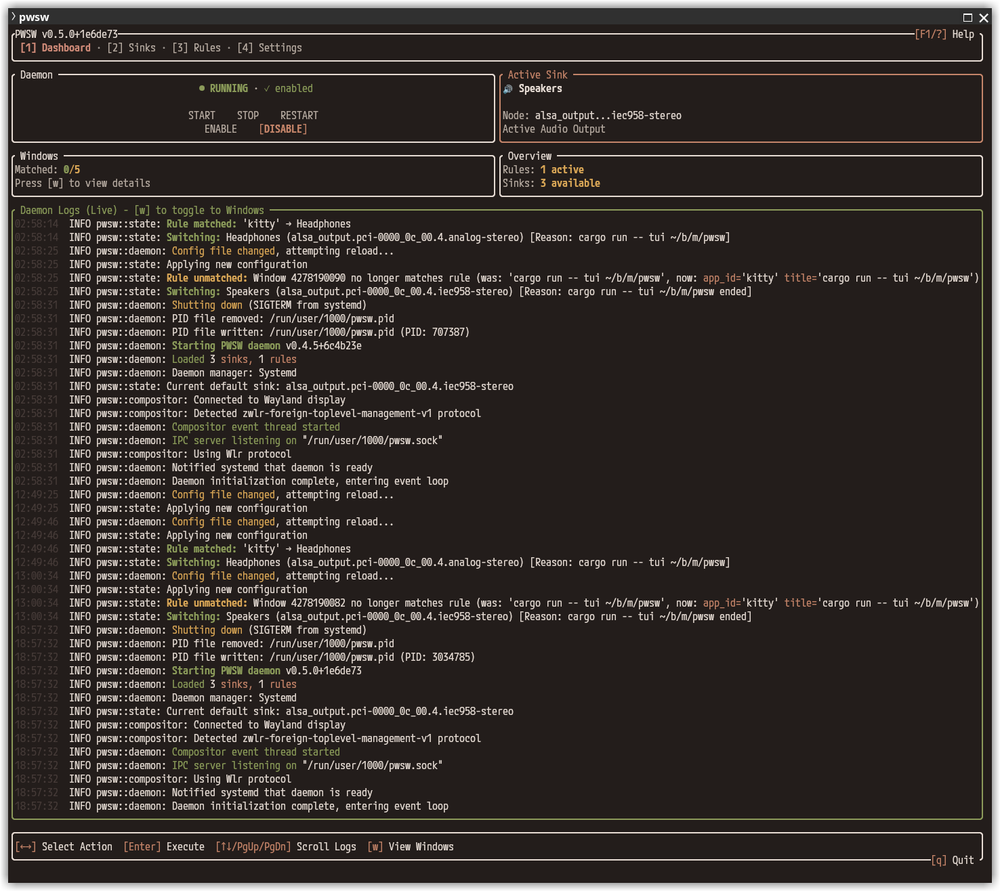

# <p align="center">PWSW - PipeWire Switcher</p>

<p align="center">
  <a href="https://github.com/ledati16/pwsw/actions/workflows/ci.yml"></a>
  <a href="LICENSE"></a>
  <a href="https://www.rust-lang.org/"></a>
  <a href="Cargo.toml"></a>
  <a href="https://ratatui.rs/"></a>
  <a href="#appendix-llm-generated-code"></a>
</p>

<p align="center"></p>

## What is PWSW?

PWSW automatically switches your PipeWire audio output based on the windows you have
open. Launch a game? Audio goes to the speakers. Open Discord? It switches to the
headset. Close the window? It switches back.

It watches windows through standard Wayland protocols and controls audio with
PipeWire's own command-line tools.

## Features

- **Automatic sink switching** from rules that match a window's `app_id` and title (regex)
- **Fallback sinks**: a rule can list several sinks; the first one available right now
  wins (e.g. Bluetooth headphones when connected, wired ones otherwise)
- **Respects your choices**: pwsw switches only when the rules' answer changes, so a sink
  you pick in pavucontrol (or a manual `pwsw set-sink`) stays until a rule wants
  something else
- **Interactive TUI**:
  - Dashboard with daemon status and controls, daemon log and window list
  - Rule editor with a live preview of matching windows
  - Sink editor that picks from the nodes PipeWire offers
  - Context-aware help generated from the actual key bindings
- **Priority modes**: most recently opened window wins, or the first matching rule wins
- **Profile switching**: reaches outputs that need a card profile change (e.g. analog ↔
  digital), keeping the card's microphone when possible
- **Desktop notifications** for manual and rule-driven switches (optional)
- **Hot reload**: config changes apply as soon as the file is saved (symlinks included)
- **Scripting**: `--json` output, an always-parseable `status --json`, shell completions
- **systemd integration**: notify-type user unit, current sink in `systemctl --user status`

## Supported Compositors

PWSW works with any compositor that implements one of:

- **`ext-foreign-toplevel-list-v1`**: the official Wayland standard (preferred when both
  are offered)
- **`wlr-foreign-toplevel-management`**: wlroots-style compositors

Compositors that implement one of them include Sway, Hyprland, Niri, River, Wayfire,
labwc, dwl and COSMIC.

**Not supported:** GNOME/Mutter (exposes neither protocol) and KDE Plasma 6 (removed its
window-management protocol and does not implement `ext` yet).

## Installation

Requirements: PipeWire with `pw-dump`, `pw-metadata` and `pw-cli` in `PATH` (part of
PipeWire), usually WirePlumber, and a notification daemon if you want notifications.
Building needs Rust 1.100; with `rustup`, the pinned toolchain from `rust-toolchain.toml`
is installed automatically.

### Arch Linux (PKGBUILD)

```bash
cd contrib
makepkg -si
```

Builds `pwsw-git` from the latest commit and installs the binary, the systemd user unit,
man pages (`pwsw(1)`, `pwsw(5)`), bash/zsh/fish completions, a desktop entry and icons.
See [contrib/README.md](contrib/README.md).

### Cargo

```bash
cargo install --path .        # installs ~/.cargo/bin/pwsw
pwsw completions bash > ~/.local/share/bash-completion/completions/pwsw   # optional
```

Man pages and the systemd unit are not installed this way; see
[contrib/README.md](contrib/README.md#manual-installation-cargo-users) for the unit.

### First run

```bash
pwsw list-sinks      # see your audio outputs and their node names
pwsw init            # write a commented config to ~/.config/pwsw/config.toml
$EDITOR ~/.config/pwsw/config.toml   # or: pwsw tui
pwsw validate        # check it
```

Then start the daemon, either with systemd (recommended):

```bash
systemctl --user enable --now pwsw.service
```

or directly with `pwsw daemon` (detaches and keeps running after the terminal closes).
The daemon refuses to start until at least one sink is configured.

## Usage

### Interactive TUI

```bash
pwsw tui
```

Use `Tab` or `1`-`4` to switch screens:
1. **Dashboard**: daemon status and Start/Stop/Restart (Enable/Disable with the systemd
   unit), the daemon log and the window list (`w` toggles)
2. **Sinks**: add, edit, reorder and delete outputs, pick the default
3. **Rules**: create and edit rules with live preview
4. **Settings**: global behaviour

`Ctrl+S` saves. Press `?` or `F1` for help on the current screen. On first run the TUI
creates the config file for you.

### Commands

| Command | What it does | Daemon |
|---------|--------------|--------|
| `pwsw` / `pwsw status [--json]` | Current audio output and daemon status | optional |
| `pwsw daemon [-f/--foreground]` | Start the daemon (background by default) | - |
| `pwsw shutdown` | Stop the daemon | required |
| `pwsw list-sinks [--json]` | Active and profile-switchable outputs | not needed |
| `pwsw list-windows [--json]` | Open windows, tracked (matching a rule) or not | required |
| `pwsw test-rule PATTERN [--json]` | Which windows a regex matches (`app_id` or title) | required |
| `pwsw validate` | Check the config file (never creates one) | not needed |
| `pwsw init [--force]` | Write the commented default config (`--force` keeps `config.toml.bak`) | not needed |
| `pwsw set-sink SINK` | Switch to a sink by description or node name | optional |
| `pwsw next-sink` / `prev-sink` | Cycle through configured sinks, skipping unavailable ones | optional |
| `pwsw tui` | Terminal UI | optional |
| `pwsw completions SHELL` | Completion script for bash, zsh, fish, elvish, powershell | - |

Global options: `--config PATH` (or `PWSW_CONFIG`) selects another config file;
`--color auto|always|never` (output is uncoloured when piped or with `NO_COLOR`).

Manual switches go through the daemon when it runs (its rules then respect the choice),
otherwise they switch PipeWire directly, so they work well as compositor key bindings.
With `set_smart_toggle`, `set-sink` on the sink that is already active switches back to
the default sink.

`status --json` always prints one JSON document and exits 0, with errors reported inside
it (schema in `man pwsw`). That makes it safe for status bars.

## Configuration

**Location:** `~/.config/pwsw/config.toml` (`$XDG_CONFIG_HOME/pwsw/config.toml`;
override with `--config PATH` or `PWSW_CONFIG`). Full reference: `man 5 pwsw`.

Only `pwsw init` and `pwsw tui` create the file. Unknown keys (typos such as
`defualt = true`) are errors naming the key and the file. Changes are picked up
automatically when the file is saved; an invalid file is rejected and the previous
configuration stays in effect. When the TUI saves, your comments and formatting are
kept, the previous version is copied to `config.toml.bak`, a symlinked config stays a
symlink, and the save is refused if the file was changed on disk in the meantime.

### Example

```toml
[settings]
default_on_startup = false # switch to the rules' sink when the daemon starts
set_smart_toggle = true    # set-sink on the active sink toggles back to the default
notify_manual = true       # notifications for manual switches and daemon events
notify_rules = true        # notifications for rule-driven switches
match_by_index = false     # false: most recent window wins; true: first rule wins
log_level = "info"         # error, warn, info, debug, trace

[[sinks]]
name = "alsa_output.pci-0000_0c_00.4.iec958-stereo"   # node name from `pwsw list-sinks`
desc = "Optical Out"
default = true

[[sinks]]
name = "alsa_output.pci-0000_0c_00.4.analog-stereo"
desc = "Headphones"
icon = "audio-headphones"   # optional; otherwise picked from the description

[[sinks]]
name = "bluez_output.40_ED_98_1C_1D_08.1"
desc = "BT Headphones"

[[rules]]
app_id = "^steam$"
title = "^Steam Big Picture Mode$"   # optional
sink = "Optical Out"                 # the sink's desc (or its node name)
desc = "Steam Big Picture"           # optional label for notifications
notify = false                       # optional per-rule override of notify_rules

[[rules]]
app_id = "^mpv$"
sink = "Headphones"

[[rules]]
app_id = "^discord$"
sink = ["BT Headphones", "Headphones"]  # fallbacks: the first one available now wins

[[rules]]
app_id = ".*"        # any app...
title = "YouTube"    # ...whose title contains "YouTube"
sink = "Headphones"
```

All `[settings]` keys are optional; the values above are the defaults.

**Sinks:** `name` is the PipeWire node name, `desc` a unique label (not a number), and
exactly one sink has `default = true`: the fallback when no rule matches. Icons are
auto-detected from the description (HDMI/TV/display → `video-display`;
headphone/headset/Bluetooth → `audio-headphones`; otherwise `audio-speakers`).

**Rules:** `app_id` (required) and `title` (optional) are regexes; `sink` names a sink by
`desc` (recommended, what the TUI writes) or node `name`. A 1-based position
(`sink = 2`) still works but is deprecated: it logs a warning and points at a different
sink if you reorder sinks by hand.

**Priority:** with `match_by_index = false` the most recently opened window that matches
a rule (or most recently started matching, e.g. after a title change) decides the sink.
With `true` the window matching the earliest rule wins (reorder rules in the TUI with
`Shift+↑/↓`). When no window matches, the default sink is used.

**Regex:** Rust `regex` syntax, matched anywhere unless anchored:

```toml
app_id = "firefox"        # substring
app_id = "^firefox$"      # exact
app_id = "^(mpv|vlc)$"    # alternatives
app_id = "(?i)discord"    # case-insensitive
```

**Finding `app_id` and title:** `pwsw list-windows` or `pwsw test-rule ".*"` (daemon
running), the TUI's Windows view, or your compositor (`swaymsg -t get_tree`,
`hyprctl clients`, `niri msg windows`).

## How switching works

- The daemon switches when the sink its rules want **changes**: a matching window opens,
  closes or changes title, or a config change alters the rules. A sink chosen elsewhere
  (pavucontrol, WirePlumber) stays until then.
- At startup it switches only with `default_on_startup = true`.
- The default is set the way `wpctl set-default` does it
  (`default.configured.audio.sink`), so WirePlumber keeps it.
- If the target needs a profile switch, pwsw picks an available profile that provides the
  output (keeping the card's microphone when possible), switches with `pw-cli` (saved in
  WirePlumber), waits up to 5 s for the new sink, then makes it the default. UCM (`HiFi`)
  and Pro Audio profiles are not switched to automatically.
- A failed rule-driven switch is retried after 2 s and 5 s, then on the next window event
  or reload.

## Troubleshooting

- **Logs:** `~/.local/share/pwsw/daemon.log` (rotated at 1 MB to `daemon.log.old`), also
  shown on the TUI dashboard. Under systemd the same lines go to
  `journalctl --user -u pwsw.service -f`. Set `log_level = "debug"` for more detail
  (applied on save, no restart needed).
- **Is it running, and on which sink?** `systemctl --user status pwsw` shows the current
  sink in its `Status:` line; `pwsw status` (or `pwsw status --json`) shows the real
  PipeWire default, the daemon's state and any errors.
- **Daemon won't start:** `pwsw validate` checks the config; `pwsw daemon --foreground`
  shows errors directly. The background `pwsw daemon` prints the error and the last log
  lines if start-up fails.
- **A rule doesn't fire:** check the window's real `app_id` with `pwsw list-windows` and
  test the pattern with `pwsw test-rule`.
- **"sink did not appear" after a profile switch:** some devices are slow; raise
  `PROFILE_SWITCH_DELAY_MS` / `PROFILE_SWITCH_MAX_RETRIES` (total wait is capped at 5 s).
- **After upgrading pwsw**, restart the daemon (`systemctl --user restart pwsw`);
  `pwsw status` tells you if the running daemon speaks a different protocol version.

## Security

- The IPC socket is `$XDG_RUNTIME_DIR/pwsw.sock` (fallback `/tmp/pwsw-<uid>/pwsw.sock`
  in a verified `0700` directory), mode `0600`; both sides check that the peer runs as
  the same user.
- Window titles and `app_id`s are treated as untrusted: control characters are escaped
  and long titles truncated in logs, and notification text cannot inject markup.
- Config files are written atomically with mode `0600`.
- The systemd unit is sandboxed (read-only system and home except pwsw's log and runtime
  directories).

## Building

```bash
cargo build --release          # target/release/pwsw
cargo test
```

Contributor setup (formatting with the pinned nightly rustfmt, clippy pedantic, the
sandboxed test runner, git hooks) is described in [CLAUDE.md](CLAUDE.md). Changes are
listed in [CHANGELOG.md](CHANGELOG.md).

## Appendix: LLM-Generated Code

> ⚠️ **Important Disclosure**

This project was **entirely generated by LLMs** (mainly Claude models) for someone
without Rust experience.

**Key facts:**
- **100% LLM-generated.** Version 0.7.0 is the result of a full overhaul that was
  planned, implemented and cross-reviewed by an orchestrated team of LLM agents
  (independent audits, re-audits and testing on real hardware by the owner)
- **Still no review by a human Rust expert**
- Works as intended with no malicious code, but use with caution
- Personal tool, not production-grade software
- **Do not package for distributions** without peer review

**Code quality:**
- Clippy pedantic enforced with `-D warnings`; the only allowed lints are listed in
  `Cargo.toml`
- PipeWire is controlled through its CLI tools with hard timeouts (process isolation,
  no FFI); config saves are validated and atomic
- Test suite runs fully sandboxed and is checked to never touch your real config
- See [CLAUDE.md](CLAUDE.md) for the standards

[Discussions](https://github.com/ledati16/pwsw/discussions) are open for community review.

**Fork and rename** if you want to maintain or improve this project (a link back is
appreciated).

Similar to [Belphemur/SoundSwitch](https://github.com/Belphemur/SoundSwitch), but for
Wayland + PipeWire.

---

**License:** [LICENSE](LICENSE) • **Discussions:** [GitHub](https://github.com/ledati16/pwsw/discussions)
